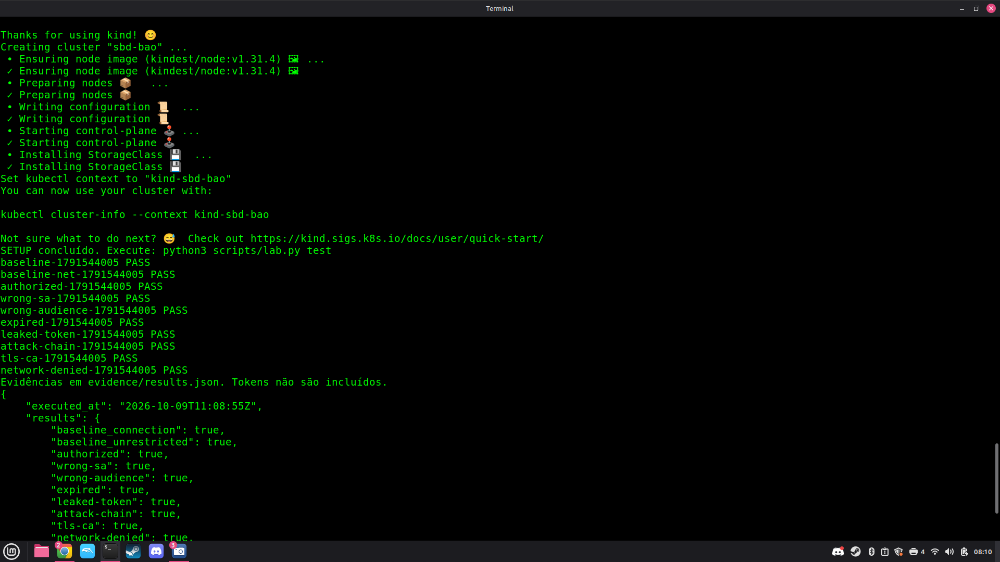
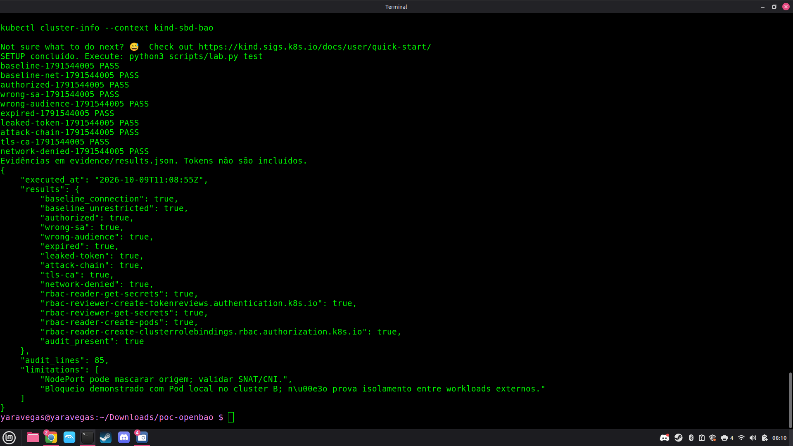

# Evidências da instalação limpa — 09/10/2026

A autora removeu os clusters anteriores, com saída `No kind clusters found`, extraiu o pacote em pasta nova e executou preflight, setup e test em sequência. As imagens foram enviadas pela autora e inspecionadas visualmente nesta revisão. Os quatro PNGs foram preservados sem alteração de pixels; o manifesto registra os hashes dos arquivos recebidos.

## Resultado observado

- Setup concluído, sem correção manual registrada entre setup e test.
- Dez Jobs PASS, identificador da rodada: 1791544005.
- Dezesseis critérios true.
- Auditoria presente: 85 linhas.
- executed_at: 2026-10-09T11:08:55Z, equivalente a 08:08:55 de Brasília.

A pendência de instalação limpa fica encerrada para esta execução A–B na máquina da autora. A evidência anterior de 08/10/2026, com 91 linhas, permanece histórica e não foi sobrescrita. Diferença de contagem, isoladamente, não demonstra falha ou melhoria de auditoria.

## Figuras

1. [Extração e comandos](01-extracao-e-comandos.png): inclui tentativa inicial sem ZIP e extração posterior bem-sucedida; o aviso de download não é erro do setup.
2. [Criação dos clusters](02-criacao-clusters.png): sequência de criação A/B.
3. [Setup e testes](03-setup-e-testes.png): conclusão do setup e dez resultados PASS.
4. [Resultado completo](04-resultado-completo.png): timestamp, 16 critérios, auditoria e limites.

## Proveniência e limites

O JSON incluído é transcrição da imagem, não o arquivo results.json original. Os logs setup-limpo.log, teste-limpo.log e logs completos dos Jobs permanecem na máquina da autora; não foram inspecionados aqui. A leitura dos prints confirma as saídas exibidas, não equivale a uma execução independente pelo assistente.

Mantêm-se as limitações: NodePort/SNAT pode mascarar origem; bloqueio demonstrado com Pod local B não comprova isolamento de workloads externos; contagem de auditoria não prova cobertura/completude; token válido vazado mantém acesso dentro do próprio escopo. Os 16 critérios aprovados não certificam produção nem as 28 práticas do modelo.
