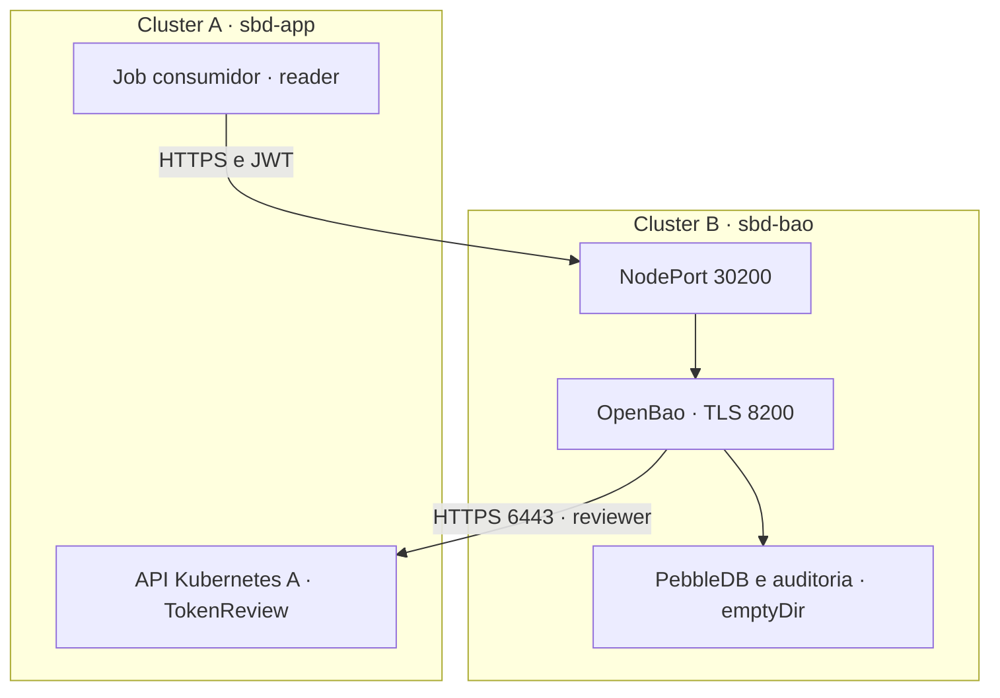

# Arquitetura implementada na POC A–B

## Componentes e fronteiras

Dois clusters kind independentes compartilham o host Docker do laboratório. A separação representa autoridades Kubernetes distintas; não oferece isolamento físico contra comprometimento do host.

O fluxo de negócio parte de A para B. B consulta a API de A para validar a identidade; portanto há comunicação de retorno B→A com finalidade e porta específicas. Não há malha geral de comunicação Pod a Pod, mTLS, service mesh ou federação de identidades.

| Componente | Implementação | Motivo e limite |
|---|---|---|
| Ambiente | kind, um nó por cluster, Docker | Reprodução local; sem HA nem isolamento de host |
| Rede | Calico 3.29.3 e NetworkPolicy | Aplicação de regras; NAT e tráfego de nó exigem validação |
| Consumidor | Job Python no namespace poc de A | Simula aplicação; não executa DAG real do GovHub |
| Identidade | ServiceAccount reader com JWT projetado | Audience openbao, duração solicitada de 600 s |
| Validação | ServiceAccount reviewer em A | Somente criar TokenReviews; token solicitado de 1 h |
| Segredos | OpenBao 2.7.1 em B | KV v2 e ACL de leitura por caminho |
| Transporte | CA local e certificado de servidor de 7 dias | Verifica CA e nome/IP; cliente sem certificado mTLS |
| Estado | PebbleDB e audit.json em emptyDir | Sobrevive a reinício de contêiner no mesmo Pod; perdido ao excluir/substituir o Pod |
| Administração | kubectl e port-forward 127.0.0.1:18200 | Bootstrap local com root; material fica em .state |

## Fluxos permitidos e finalidade

| ID | Origem → destino | Porta/protocolo | Finalidade |
|---|---|---|---|
| F01 | Job A → IP do nó B → OpenBao | TCP 30200 → 8200, HTTPS | Login e leitura de segredo fictício |
| F02 | OpenBao B → API do nó A | TCP 6443, HTTPS | TokenReview com autoridade de A |
| F03 | Operador → port-forward local → serviço B | TCP 18200 → 8200, HTTPS | Inicialização e configuração administrativa |
| F04 | Probe local B → serviço B | TCP 8200, HTTPS | Controle experimental de bloqueio local |

Os CIDRs de Pods são 192.168.0.0/17 em A e 192.168.128.0/17 em B. IPs dos nós são descobertos via Docker e não devem ser fixados a partir de um print. Os CIDRs distintos evitam sobreposição neste laboratório, mas não criam roteamento entre Pods dos clusters.

## Autenticação e autorização

1. O Job lê JWT projetado e valida certificado do OpenBao.
2. Envia JWT ao mount `auth/cluster-a`, role `reader`.
3. OpenBao consulta a API Kubernetes de A usando o reviewer.
4. A role vincula namespace `poc`, ServiceAccount `reader` e audience `openbao`.
5. OpenBao emite token com TTL e máximo configurados de 300 s; role experimental de expiração usa 30 s.
6. ACL permite ler `secret/data/app/config`. O caminho `secret/data/other/config` e ações administrativas devem ser recusados.

`reader` não recebe permissão de ler Kubernetes Secrets ou criar Pods. O reviewer recebe apenas a permissão de validação requerida. As credenciais e os tokens de cada camada não são intercambiáveis.

## NetworkPolicies efetivas

Em A, `probe-egress` seleciona Pods `app=probe` e restringe saída aos destinos e portas configurados para B. Em B, `bao-ingress` seleciona OpenBao, limita saída à API de A e permite entrada dos IPs dos nós A/B e de probes locais com rótulo autorizado. As regras são específicas aos Pods selecionados; não implementam um default-deny universal em todos os namespaces.

A permissão dos IPs dos nós acomoda o caminho NodePort do laboratório. Ela não distingue todas as identidades de workloads que podem aparecer após SNAT. O caso `network-denied` é local a B. O teste não prova uma fronteira de rede impermeável entre clusters.

## Endurecimento e estado

Namespace usa Pod Security restricted v1.31. Contêineres usam usuário não root, sem escalada de privilégios, capacidades removidas, raiz somente leitura, seccomp RuntimeDefault e limites de recursos. Os volumes necessários continuam graváveis. Esses controles reduzem superfície; não demonstram resistência a escape de contêiner.

OpenBao usa TLS, modo servidor normal e auditoria declarativa. Há apenas uma réplica; unseal 1/1 e root em arquivo local são concessões de laboratório. Não há backup/restore, armazenamento persistente, auto-unseal, rotação automática de CA ou coletor de auditoria externo.

## Versões e reprodutibilidade

O script fixa `kindest/node:v1.31.4`, Calico 3.29.3 e OpenBao 2.7.1; o probe usa `python:3.12-alpine`, uma tag mutável. A autora informou kubectl 1.36.0, Docker 29.1.3, Python 3.12.3, OpenSSL 3.0.13 e kind 0.32.0-alpha. A execução observada não comprova compatibilidade suportada desse conjunto; kubectl 1.36 e API 1.31 estão fora da diferença de uma versão minor suportada para esse cliente, conforme a política oficial. Corrigir esse desvio antes de nova reprodução. Preferir cliente dentro da política de version skew e uma combinação suportada em adoção real.

Digest OpenBao observado no diagnóstico da autora: `sha256:6d2b93856e3fcf7b18ad855a0b51eaba474dc8b79cf554379ea32034797d2acf`. O script permite `POC_BAO_IMAGE`; alterar a imagem exige repetir a validação. O digest observado não é uma análise de vulnerabilidades.
